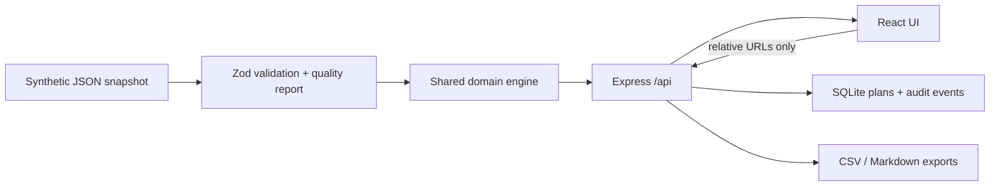

# Architecture

## Decision

A single-origin TypeScript application: React/Vite UI, Express API, shared domain engine, and Node 22 built-in SQLite for demo workflow persistence. The dataset is a validated, versioned JSON snapshot generated reproducibly from synthetic inputs. This is intentionally smaller than a production health-information system.

## Why this stack

- **TypeScript end to end:** one set of types and formulas for server/UI; strict checking catches contract drift.
- **React + Vite:** fast iteration and a usable browser demo without a separate frontend origin.
- **Express:** small, explicit API surface and easy integration tests.
- **SQLite (`node:sqlite`):** durable local plans/audit without an external database service. Node 22 marks this API experimental; the repository isolates it so a production adapter can replace it.
- **Zod:** runtime validation at dataset and HTTP boundaries.
- **Deterministic engine:** reproducible triage/allocation without credentials or network calls. Retrieval is labeled as retrieval, not generative AI.

## Modules

| Path | Responsibility |
|---|---|
| `shared/types.ts`, `shared/schemas.ts` | Contracts and validation |
| `shared/domain.ts` | Dates, demand, FEFO projection, risk, quality |
| `shared/planner.ts` | Candidate generation, safety constraints, exact MILP orchestration, simulation |
| `shared/optimizer.ts` | HiGHS fixed-charge integer-flow MILP, optimality certificate, feasibility re-check |
| `shared/countries.ts`, `shared/imports.ts` | Country profiles, authorized aggregate pack validation/privacy preview |
| `shared/clinical-policy.ts` | Safety guardrails, local approval gate, prioritization weights |
| `shared/evidence.ts` | Bounded retrieval and grounded briefing |
| `shared/export.ts` | Formula-safe CSV |
| `server/repository.ts` | SQLite schema, transactions, plan snapshots, audit |
| `server/app.ts` | API routes, validation, errors, exports |
| `server/index.ts` | Host/port, Vite middleware or built-client serving |
| `src/` | Pages, components, API client, design system |
| `scripts/generate-data.ts` | Deterministic synthetic snapshot and manifest |

## Request flows

### Read path
UI requests `/api/overview`, `/api/risks`, or `/api/meta` → server validates query → loads validated in-memory snapshot → shared engine computes results → JSON response. The fixed snapshot date, not the wall clock, drives calculations.

### Scenario path
UI posts budget/horizon/buffer/scope/country → Zod validation → country/data/clinical gates → candidate generation → exact HiGHS MILP → independent feasibility check → selected/unfunded actions, optimality certificate, assumptions, dataset hash, and before/after estimates. Saving posts the scenario and an idempotency key; the server recomputes rather than trusting client costs.

### Workflow path
Save creates a plan and item snapshots in one transaction. Approval and item advancement use expected-state checks and append audit events atomically. There are no external side effects. The actor is the explicit `Demo analyst`; this is not authenticated identity.

## Persistence

SQLite stores workflow state only. The immutable demo dataset remains in files; plans retain their scenario/result snapshots and dataset version. Tables: `plans`, `plan_items`, `audit_events`, and `schema_meta`. Database files live under gitignored `.data/`. See [Operations](OPERATIONS.md).

## Hosting boundary

Development uses Vite middleware inside Express. Production serves `dist/client` and the bundled Express server on the same port. Bind to `0.0.0.0`; allow localhost and the Arena `.e2b.app` preview suffix (or configured exact deployment hosts). Browser code never references localhost or a backend port.

## Deliberate limitations

One shared demo workspace, no auth/roles/tenant isolation, no live government API connectors, no background jobs, no real routing, no LLM provider, and no production migration/backup service. Operator-controlled authorized aggregate file ingestion exists but is disabled in the public demo. The SQLite adapter and file-based dataset are replaceable boundaries, not claims of production readiness.

## Extension points

1. Ingestion adapter → authorized aggregate observations + quarantine + lineage + country custodian authentication.
2. Forecast adapter → backtested model with the same risk contract.
3. Allocation adapter → locally approved equity/clinical constraints over the exact MILP contract.
4. LLM adapter → retrieved evidence + deterministic tool results; validated citations; no action authority.
5. Identity/workflow adapters → authenticated roles and authoritative procurement/finance systems.
